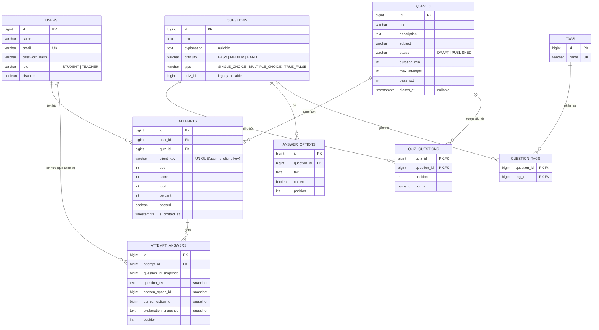

<div align="center">

# Ánh Dương Quiz

**Nền tảng quản lý & đánh giá bài kiểm tra trực tuyến**

Giáo viên soạn đề từ ngân hàng câu hỏi dùng chung · Học sinh làm bài có bấm giờ, xem lại kết quả

Java 21 · Spring Boot 3.3 · PostgreSQL 16 · React 18 · TypeScript · Docker

</div>

---

## 📋 Mục lục

- [Tính năng](#-tính-năng)
- [Công nghệ sử dụng](#-công-nghệ-sử-dụng)
- [Mô hình dữ liệu](#-mô-hình-dữ-liệu)
- [Chạy dự án](#-chạy-dự-án)
- [Tài khoản demo](#-tài-khoản-demo)
- [API](#-api)
- [Quy tắc nghiệp vụ](#-quy-tắc-nghiệp-vụ)
- [Kiểm thử](#-kiểm-thử)
- [Điểm kỹ thuật đáng chú ý](#-điểm-kỹ-thuật-đáng-chú-ý)
- [Bảo mật](#-bảo-mật)
- [Hạn chế đã biết](#-hạn-chế-đã-biết)
- [Cấu trúc repo](#-cấu-trúc-repo)
- [Tài liệu](#-tài-liệu)
- [License](#-license)

---

## ✨ Tính năng

### 🎓 Học sinh

| Tính năng | Mô tả |
|---|---|
| **Dashboard cá nhân** | Chào hỏi theo giờ, thống kê nhanh (số đề đang mở, trung bình điểm), đề nổi bật và các lượt làm gần nhất |
| **Danh sách bài kiểm tra** | Xem các đề đang xuất bản, lọc theo môn, biết rõ còn bao nhiêu lượt làm |
| **Làm bài có bấm giờ** | Đếm ngược trên giao diện, tự động nộp bài khi hết giờ |
| **Nộp bài chống gửi trùng** | `clientKey` sinh ra mỗi lần làm bài — gửi lại cùng key sẽ trả về đúng kết quả cũ thay vì tạo bài mới |
| **Lịch sử làm bài** | Phân trang, lọc theo từng đề, xem điểm số và trạng thái đạt/không đạt |
| **Xem lại bài đã làm** | Từng câu: đáp án đã chọn, đáp án đúng, kết quả đúng/sai kèm giải thích |
| **Làm lại bài** | Cho phép làm lại trong số lượt còn lại nếu đề còn mở |

### 👨‍🏫 Giáo viên

| Tính năng | Mô tả |
|---|---|
| **Dashboard giáo viên** | Tổng quan số bài đã xuất bản, bản nháp, tổng lượt thi |
| **Soạn đề thi** | Cấu hình tên, mô tả, môn học, thời gian, số lượt làm, điểm đạt, hạn đóng |
| **Ngân hàng câu hỏi** | Tìm câu hỏi theo nội dung (không phân biệt hoa thường), lọc theo độ khó và thẻ chủ đề |
| **Quản lý thẻ chủ đề** | Tạo / xoá thẻ để gom câu hỏi theo mạng lưới kiến thức (VD: *"Biến và kiểu dữ liệu"*, *"Kế thừa OOP"*) |
| **Mượn câu hỏi dùng chung** | Thêm câu đã có trong ngân hàng vào đề — **không tạo bản sao**, một câu dùng được cho nhiều đề |
| **Gỡ câu khỏi đề** | Gỡ liên kết nhưng câu hỏi vẫn nằm trong ngân hàng, các đề khác không bị ảnh hưởng |
| **Soạn câu hỏi** | Tạo / sửa câu hỏi trắc nghiệm kèm giải thích, chọn đáp án đúng |
| **Kiểm tra điều kiện xuất bản** | 5 điều kiện được kiểm tra ngay trên UI, chưa đủ thì chưa cho xuất bản |
| **Xuất bản / Gỡ xuất bản** | Bài ở trạng thái nháp ẩn hoàn toàn với học sinh |
| **Bảng kết quả** | Xem điểm, tỉ lệ đạt và thời điểm nộp của từng học sinh theo từng đề |

### ⚙️ Hệ thống

| Tính năng | Mô tả |
|---|---|
| **Phân quyền theo vai trò** | JWT kèm role `STUDENT` / `TEACHER`, chặn ở cả SecurityFilterChain lẫn `@PreAuthorize` |
| **Lịch sử làm bài bất biến** | Khi nộp bài, toàn bộ nội dung câu hỏi – đáp án – giải thích được chép lại; giáo viên sửa câu hỏi sau này không làm thay đổi bài đã chấm |
| **Chống dò tài khoản** | Đề bản nháp trả về `404` thay vì `403` cho học sinh |
| **Kiểm soát thời gian server-side** | Máy chủ tự xác nhận `startedAt + thời lượng + 30s đệm`, không tin timer trên trình duyệt |
| **Chuẩn hoá lỗi** | Mọi lỗi trả về cùng một cấu trúc JSON kèm mã nghiệp vụ |
| **Giao diện** | Hỗ trợ sáng/tối theo hệ thống, responsive, có bộ component dùng lại + trang UI Kit |

---

## 🛠 Công nghệ sử dụng

| Lớp | Công nghệ |
|---|---|
| **Backend** | Java 21, Spring Boot 3.3, Spring Web, Spring Data JPA, Spring Security, Spring Validation, Flyway, JJWT 0.12 (HS384), springdoc-openapi 2.6 |
| **Database** | PostgreSQL 16 · 9 bảng · quản lý schema bằng Flyway migration |
| **Frontend** | React 18, TypeScript, Vite 5, React Router 6, TanStack Query 5, React Hook Form + Zod, Tailwind CSS 3, Vitest + Testing Library |
| **Hạ tầng** | Docker Compose (3 dịch vụ), GitHub Actions (CI build + test cho cả hai phía), Nginx (phục vụ bản build production) |
| **Kiểm thử** | JUnit 5, AssertJ, RestTemplate integration test trên PostgreSQL thật |

**Quy mô dự án:** 26 REST endpoint · 9 bảng · 25 test · 14 màn hình · 11 file component dùng lại · ~6.300 dòng code

---

## 🗄 Mô hình dữ liệu

Cốt lõi của hệ thống là **ngân hàng câu hỏi**: câu hỏi tồn tại **độc lập**, không thuộc về đề
nào. Đề thi chỉ *mượn* câu hỏi qua bảng nối trung gian — quan hệ **nhiều–nhiều**.



**Vì sao tách bảng nối?**

| | `questions.quiz_id` (1–N cũ) | `quiz_questions` (N–N mới) |
|---|---|---|
| Tái sử dụng câu hỏi | Phải copy sang bài mới | Dùng lại trực tiếp, không copy |
| Sửa câu hỏi gốc | Mỗi bài một bản, lệch nhau | Sửa một chỗ, áp dụng cho mọi đề |
| Thứ tự câu hỏi | Nằm ở bảng `questions` | Nằm ở bảng nối, đúng chỗ ngữ nghĩa |
| Đánh đổi | Đơn giản | Phải join thêm 1 bảng |

Lịch sử làm bài vẫn an toàn nhờ **snapshot**: khi nộp bài, nội dung câu hỏi, đáp án đúng,
đáp án đã chọn và giải thích đều được chép vào `attempt_answers`.

> `questions.quiz_id` còn lại (nullable) để tương thích ngược với dữ liệu cũ; mọi liên kết
> và thứ tự hiện đã đi qua `quiz_questions`.

> ⚠️ `docs/ER.md` hiện **chưa cập nhật** theo mô hình mới. Sơ đồ trong README là bản
> chính xác tại thời điểm này.

---

## 🚀 Chạy dự án

### Yêu cầu

- **Cách A:** Docker + Docker Compose
- **Cách B:** JDK 21, Node.js 20, PostgreSQL 16 (hoặc Docker chỉ cho database)

### Cách A — Docker Compose (nhanh nhất)

```bash
cp .env.example .env
docker compose up -d --build       # hoặc: ./scripts/prod-up.sh
```

| | |
|---|---|
| Ứng dụng | <http://localhost:5173> |
| API docs (Swagger) | <http://localhost:8080/swagger-ui.html> |
| OpenAPI | <http://localhost:8080/v3/api-docs> |

```bash
docker compose down                # dừng
```

> **Khi đang viết code, hãy dùng Cách B.** Trong Docker, sửa `.java`/`.tsx` phải build lại
> mới thấy — không có F5.

### Cách B — Môi trường phát triển (khuyến nghị khi code)

Ý tưởng: chỉ **database** chạy trong Docker, backend và frontend chạy trực tiếp trên máy
để có hot reload.

```bash
# Bước 0 — chỉ bật PostgreSQL
cp .env.example .env
./scripts/dev-up.sh                 # = docker compose up -d postgres

# Bước 1 — Terminal 1: backend
cd backend
mvn spring-boot:run

# Bước 2 — Terminal 2: frontend
cd frontend
npm install
npm run dev
```

Mở <http://localhost:5173> — Vite proxy `/api` sang cổng `8080`.
Dừng: đóng 2 terminal rồi `./scripts/dev-down.sh`.

**Không cần khai báo biến môi trường**: `application.yml` đã mặc định profile `dev`
(bật sẵn dữ liệu mẫu) và trỏ `localhost:5432` với user `quiz`/`quiz`. Nếu đổi cấu hình
Postgres thì khai báo thêm:

```bash
SPRING_DATASOURCE_URL=jdbc:postgresql://localhost:<port>/quizdb \
SPRING_DATASOURCE_USERNAME=quiz SPRING_DATASOURCE_PASSWORD=quiz \
mvn spring-boot:run
```

### Lưu ý về hot reload

| | Cách hoạt động |
|---|---|
| **Frontend** | Vite HMR — sửa `.tsx`, F5 là thấy ngay |
| **Backend** | Spring DevTools theo dõi `target/classes` và tự restart (~1–2s) |

Backend **chỉ restart khi file `.class` thay đổi**, tức là cần trình biên dịch biên dịch
lại trước. Với IntelliJ IDEA / VS Code (kèm Java extension) việc này tự động. Nếu dùng
trình soạn thảo đơn giản, chạy `mvn compile` song song.

> Nếu `Ctrl+C` không dừng hẳn backend, tiến trình JVM con còn sót lại và giữ cổng 8080:
> `kill $(lsof -ti:8080)`.

Schema do **Flyway** quản lý (`V1__init.sql`, `V2__question_bank.sql`); Hibernate chỉ
`validate` — không tự tạo bảng.

---

## 👤 Tài khoản demo

Chỉ có khi chạy profile `dev` hoặc `test` (biến `SPRING_PROFILES_ACTIVE=prod` sẽ tắt seed).

| Vai trò | Email | Mật khẩu |
|---|---|---|
| Học sinh | `hocsinh@demo.vn` | `Demo@1234` |
| Giáo viên | `giaovien@demo.vn` | `Demo@1234` |
| Học sinh | `minh@demo.vn` | `Demo@1234` |
| Học sinh | `ha@demo.vn` | `Demo@1234` |

---

## 🔌 API

Tất cả trả về JSON; lỗi theo cấu trúc thống nhất
`{ status, code, message, details, path, timestamp }`.

### Công khai & học sinh

| Method | Path | Mô tả |
|---|---|---|
| `POST` | `/api/auth/register` | Đăng ký (luôn tạo tài khoản `STUDENT`) |
| `POST` | `/api/auth/login` | Đăng nhập, trả JWT |
| `GET` | `/api/users/me` | Thông tin người dùng hiện tại |
| `GET` | `/api/me/dashboard` | Dashboard học sinh: thống kê + đề nổi bật + lượt làm gần nhất |
| `GET` | `/api/quizzes` | Danh sách đề đang xuất bản |
| `GET` | `/api/quizzes/{id}` | Chi tiết đề + câu hỏi *(không kèm đáp án đúng)* |
| `POST` | `/api/quizzes/{id}/attempts` | Nộp bài *(idempotent qua `clientKey`)* |
| `GET` | `/api/attempts/me` | Lịch sử làm bài, có phân trang |
| `GET` | `/api/attempts/{id}` | Chi tiết lượt làm + phần xem lại |

### Giáo viên

| Method | Path | Mô tả |
|---|---|---|
| `GET` | `/api/admin/stats` | Thống kê dashboard giáo viên |
| `GET` `POST` | `/api/admin/quizzes` | Liệt kê / tạo đề |
| `GET` `PUT` | `/api/admin/quizzes/{id}` | Đọc / sửa đề *(giới hạn khi đã có lượt làm)* |
| `POST` | `/api/admin/quizzes/{id}/publish` | Xuất bản — `422` nếu chưa đủ điều kiện |
| `POST` | `/api/admin/quizzes/{id}/unpublish` | Gỡ xuất bản |
| `POST` | `/api/admin/quizzes/{id}/questions` | Tạo câu hỏi mới trong đề |
| `PUT` `DELETE` | `/api/admin/questions/{questionId}` | Sửa / xoá câu hỏi |
| `GET` | `/api/admin/quizzes/{id}/attempts` | Bảng kết quả của giáo viên |

### Ngân hàng câu hỏi

| Method | Path | Mô tả |
|---|---|---|
| `GET` | `/api/admin/questions` | Tìm trong ngân hàng — `?search=&difficulty=&tagId=` |
| `POST` | `/api/admin/quizzes/{quizId}/questions/{questionId}` | Mượn câu hỏi vào đề *(không copy)* |
| `DELETE` | `/api/admin/quizzes/{quizId}/questions/{questionId}` | Gỡ câu hỏi khỏi đề *(câu vẫn còn trong ngân hàng)* |
| `GET` `POST` | `/api/admin/tags` | Liệt kê / tạo thẻ chủ đề |
| `DELETE` | `/api/admin/tags/{tagId}` | Xoá thẻ |

Tài liệu đầy đủ kèm mã lỗi: [`docs/API.md`](docs/API.md) · Swagger UI: `/swagger-ui.html`

---

## 📏 Quy tắc nghiệp vụ

- **Kiểm tra điều kiện xuất bản (server-side)** — 5 điều kiện: tiêu đề ≥ 3 ký tự · có ít
  nhất 1 câu hỏi · mỗi câu có ≥ 2 đáp án · mỗi câu có đúng 1 đáp án đúng · hạn đóng còn
  tương lai.
- **Đề đã xuất bản bị khoá cấu trúc** — không thêm/gỡ câu hỏi; phải gỡ xuất bản trước.
- **Đề có lượt làm bị khoá nội dung** — không xoá câu/đáp án, không đổi đáp án đúng (`409`).
- **Idempotency khi nộp bài** — `UNIQUE(user_id, client_key)`. Client gửi lại cùng
  `clientKey` nhận đúng kết quả cũ; race được xử lý qua `DataIntegrityViolationException`.
- **Ẩn đề bản nháp** — học sinh gọi API đề nháp nhận `404` (không phải `403`) để tránh dò tài khoản.
- **Bộ đếm thời gian do server quyết định** — `startedAt + durationMin + 30 giây đệm`.
- **Không lộ đáp án** — JSON trả về cho học sinh không chứa trường `correct` hay `explanation`.

---

## 🧪 Kiểm thử

```bash
docker compose up -d postgres     # test backend cần PostgreSQL chạy

cd backend  && mvn -B -ntp test   # JUnit 5 — 25 test
cd frontend && npm test           # Vitest
```

| Lớp test | Phạm vi |
|---|---|
| Unit — publish checks | 5 điều kiện xuất bản |
| Unit — validation (Vitest) | Schema login / register / quiz |
| Integration — auth & làm bài | Phân quyền, đề nháp 404, JSON không lộ đáp án, chấm điểm, idempotency (cùng & khác `clientKey`), validate câu trả lời sai |
| Integration — ngân hàng câu hỏi (18 case) | Tìm kiếm không phân biệt hoa thường, lọc độ khó / thẻ, vòng đời thẻ, mượn–gỡ câu hỏi, `usageCount` tăng đúng khi mượn, 1 câu dùng chung 2 đề, chặn thêm câu vào đề đang xuất bản, đánh dấu câu nằm trong đề đã xuất bản |
| Kiểm thử thủ công | Luồng giáo viên tạo → xuất bản, học sinh làm → xem lại, đổi theme, responsive |

**Kết quả hiện tại: backend 25/25 xanh · frontend 6/6 xanh.**

---

## 💡 Điểm kỹ thuật đáng chú ý

Những quyết định và bài học rút ra trong quá trình phát triển:

### 1. Specification thay vì điều kiện động trong JPQL

Tìm câu hỏi cần lọc theo 3 tiêu chí tuỳ ý (nội dung, độ khó, thẻ). Cách viết quen thuộc:

```java
WHERE (:search IS NULL OR LOWER(q.text) LIKE ...)   // ❌
```

Hibernate 6 **không suy luận được kiểu của tham số `null`** trong biểu thức này, PostgreSQL
hiểu nó là `bytea` và báo `function lower(bytea) does not exist`. Thêm `CAST` cũng không
cứu được vì tham số `null` vẫn bị bind sai kiểu.

Giải pháp: dùng **JPA Specification** — mỗi điều kiện trả về `null` khi không dùng,
Spring Data tự bỏ qua, nên SQL luôn chỉ chứa tham số có kiểu rõ ràng.

### 2. `@EntityGraph` để không dính lỗi N+1

Danh sách câu hỏi cần hiển thị đáp án. Truy vấn mặc định sẽ phát sinh 1 câu lệnh cho
danh sách + N câu lệết cho options. `@EntityGraph(attributePaths = "options")` gộp vào
cùng một câu lệnh; phía service chỉ cần gộp trùng do `join fetch` trên collection.

### 3. Bốn lỗi nghiêm trọng phát hiện được nhờ test tích hợp

Test tích hợp chạy trên PostgreSQL thật (không mock) đã phơi ra những lỗi mà `mvn compile`
hoàn toàn không bắt được:

| Lỗi | Hệ quả |
|---|---|
| Thiếu gán quan hệ khi tạo đáp án | `question_id` NULL vi phạm NOT NULL → **tính năng thêm câu hỏi chưa từng chạy được** |
| Sắp xếp theo cột đã chuyển nullable | `NullPointerException` khi học sinh nộp bài |
| Cấu hình test trỏ sai cổng Postgres | **CI chạy đỏ** |
| Tham số `null` trong JPQL sinh SQL sai kiểu | `lower(bytea) does not exist` |

### 4. Phân biệt "gỡ khỏi đề" và "xoá khỏi ngân hàng"

Sau khi tách `quiz_questions`, một câu hỏi có thể nằm trong nhiều đề. Xoá theo kiểu cũ sẽ
gỡ nó khỏi **mọi** đề. Vì vậy API tách rõ hai hành động:

- `DELETE /quizzes/{quizId}/questions/{questionId}` → chỉ gỡ liên kết, câu hỏi còn trong bank
- `DELETE /admin/questions/{questionId}` → xoá hẳn khỏi ngân hàng, ảnh hưởng tất cả đề

---

## 🔐 Bảo mật

- Mật khẩu băm bằng **BCrypt**, không ghi log hash.
- **JWT HS384**, hạn 60 phút, secret lấy từ biến môi trường.
- Phân quyền 2 lớp: `SecurityFilterChain` + `@PreAuthorize` (defense-in-depth).
- **CORS whitelist** qua `ALLOWED_ORIGINS`.
- Lỗi `401` chuyển hướng về `/login`; `403` có trang riêng.
- JWT lưu trong bộ nhớ React + `sessionStorage` (xem [`docs/DECISIONS.md`](docs/DECISIONS.md)).
- **Không commit secret thật vào git** — tham chiếu `.env.example`.
- Không dùng cho production trước khi đã review bảo mật, khả năng mở rộng và xoay vòng secret.

---

## ⚠️ Hạn chế đã biết

- **Chưa phân trang** cho ngân hàng câu hỏi và danh sách đề — hiện trả về toàn bộ, sẽ cần
  giới hạn khi dữ liệu lớn.
- **Timer auto-submit** mới kiểm thử thủ công; chưa có test tích hợp với `Clock` mock.
- **Race condition khi nộp bài** đã xử lý bằng constraint ở tầng DB nhưng chưa có test
  tự động với nhiều luồng (Spring test runner serialize theo class).
- **Chưa có phân tích kết quả** (biểu đồ độ khó theo câu, xu hướng theo thời gian).
- **Chưa hỗ trợ nhập câu hỏi hàng loạt** từ DOCX/CSV.
- **Chỉ hỗ trợ tiếng Việt**, đúng như yêu cầu bản demo gốc.
- `docs/ER.md` chưa cập nhật theo mô hình ngân hàng câu hỏi.

---

## 📁 Cấu trúc repo

```
quiz-app/
├── backend/                          # Spring Boot 3 + Java 21
│   └── src/main/java/com/anhtduong/quiz/
│       ├── auth/                     # đăng nhập, đăng ký
│       ├── user/                     # UserEntity, /api/users/me
│       ├── security/                 # JwtService, JwtAuthFilter, SecurityConfig
│       ├── quiz/                     # API + service phía học sinh
│       ├── question/                 # Question, AnswerOption + ngân hàng câu hỏi
│       │                             #   (QuizQuestion, Tag, QuestionTag, Specification)
│       ├── attempt/                  # nộp bài, snapshot, idempotency
│       ├── admin/                    # CRUD đề, xuất bản, quản lý câu hỏi
│       ├── common/                   # ApiError, BusinessException, GlobalExceptionHandler
│       ├── config/                   # OpenAPI
│       └── seed/                     # DataSeeder (chỉ chạy ở dev/test)
│   └── src/main/resources/db/migration/
│       ├── V1__init.sql
│       └── V2__question_bank.sql     # tách câu hỏi khỏi đề, thêm bảng nối + thẻ
│
├── frontend/                         # React 18 + TypeScript + Vite
│   └── src/
│       ├── pages/                    # 14 màn hình
│       ├── components/               # 11 file component dùng lại
│       ├── features/                 # api client (axios), validation (zod)
│       ├── lib/                      # api, auth, theme, format, toast
│       └── test/                     # test vitest
│
├── docs/                             # tài liệu thiết kế
├── demo/                             # bản demo HTML gốc (thiết kế UI/UX được duyệt)
├── scripts/                          # dev-up.sh · dev-down.sh · prod-up.sh
├── .github/workflows/ci.yml          # CI
├── docker-compose.yml
└── README.md
```

---

## 📚 Tài liệu

| Tài liệu | Nội dung |
|---|---|
| [`docs/API.md`](docs/API.md) | Mô tả API kèm mã lỗi nghiệp vụ |
| [`docs/ARCHITECTURE.md`](docs/ARCHITECTURE.md) | Sơ đồ kiến trúc *(chưa cập nhật ngân hàng câu hỏi)* |
| [`docs/ER.md`](docs/ER.md) | Sơ đồ ER và lý do ràng buộc *(chưa cập nhật)* |
| [`docs/DECISIONS.md`](docs/DECISIONS.md) | Các quyết định kỹ thuật kèm lý do |
| [`docs/INTERVIEW.md`](docs/INTERVIEW.md) | Chuỗi câu hỏi phỏng vấn kèm gợi ý trả lời |
| [`docs/AUDIT.md`](docs/AUDIT.md) | Đánh giá repo tại thời điểm bắt đầu |
| [`demo/Ánh Dương Quiz.html`](demo/Ánh%20D%C6%B0%C6%A1ng%20Quiz.html) | Bản demo HTML gốc |

---

## 📄 License

Mã nguồn mở cho mục đích học tập và portfolio. **Không dùng cho production** khi chưa
review bảo mật, khả năng mở rộng và quy trình xoay vòng secret.
