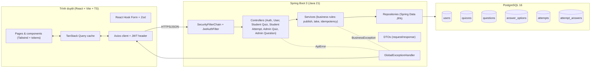

# Kiến trúc (M7)

## Layer backend

- **controller**: HTTP in/out, ánh xạ DTO, kiểm tra phân quyền bằng `@PreAuthorize` hoặc SecurityConfig.
- **service**: business rules, `@Transactional`, đặt thời gian bắt đầu, chấm điểm, snapshot.
- **repository**: `JpaRepository`, query lấy attempts của user, attempts của quiz.
- **dto**: mọi thứ request/response, không bao giờ trả entity.
- **security**: BCrypt, JWT (jjwt), SecurityFilterChain, role hierarchy.
- **exception** (`GlobalExceptionHandler`): một format lỗi duy nhất `{status, code, message, details, path, timestamp}`.

## Layer frontend

- **Pages**: chỉ compose, không chứa logic. Mỗi page có skeleton, empty, error, retry, 401, 403.
- **Features**: `auth`, `quizzes`, `attempts`, `teacher/quizzes`, `teacher/questions` - hook + API call + DTO type.
- **Components**: Button, Field, Banner, Pill, Card, Stat, Modal, Skeleton, EmptyState, QuestionNavigator, ThemeSwitch, TopBar, AppShell.
- **Lib**: `api.ts` (axios instance + interceptor gắn JWT), `theme.ts` (quản lý `data-theme`), `format.ts` (vi-VN).

## Tại sao chọn stack này

- **Spring Boot 3 + Java 21**: yêu cầu của đề bài; ecosystem chín muồi; record class + pattern matching giúp giảm boilerplate.
- **PostgreSQL 16 + Flyway**: SQL thật, migrations có version, CHECK constraints được test.
- **React + Vite + TS**: SPA nhanh, không cần SSR (bài kiểm tra có auth, không có SEO).
- **TanStack Query**: caching + retry tự động cho production.
- **React Hook Form + Zod**: validation client giống validation server 1-1.
- **Tailwind + design tokens**: đúng yêu cầu demo (CSS variables + tailwind.config ánh xạ tên token).

## Bảo mật

- JWT secret lấy từ env (`JWT_SECRET`, đặt mặc định cho dev profile, fail nếu thiếu ở prod).
- BCrypt password hashing, không log hash.
- Lỗi 401 đẩy về `/login` kèm banner cảnh báo.
- Lỗi 403 có trang riêng.
- Tất cả `/api/admin/**` yêu cầu role `TEACHER`, kiểm tra ở cả SecurityFilterChain lẫn `@PreAuthorize` (defense-in-depth).
- Mọi endpoint `/api/quizzes/{id}` (sinh viên) trả 404 nếu quiz là `DRAFT` hoặc không tồn tại - chống enumeration.

## Hiệu năng

- Index trên `(user_id, submitted_at)` và `(quiz_id, submitted_at)`.
- Cache TanStack Query 30s cho danh sách.
- Không N+1: load `quiz + questions + options` bằng 1 câu JPQL `JOIN FETCH` (chỉ dùng trong giáo viên xem/sửa quiz; sinh viên lấy bằng 2 truy vấn để tránh fetch answer đúng).
